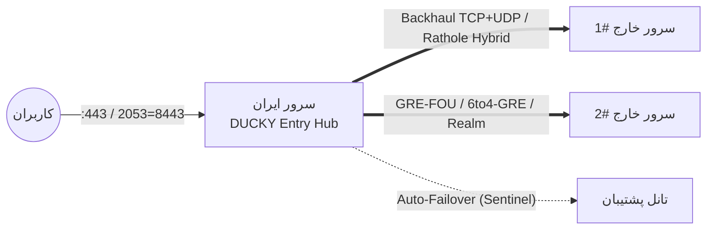
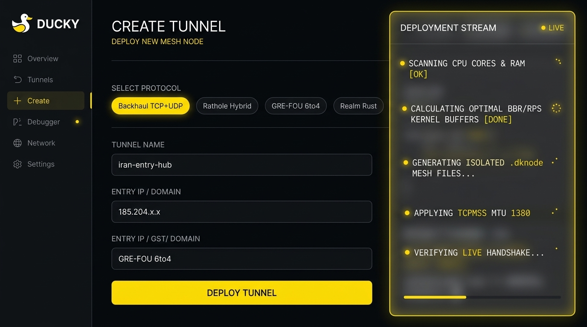

<p align="center">
  
</p>

<p align="center">
  
</p>

<p align="center">
  <a href="#فارسی"></a>
  <a href="#english"></a>
  <a href="https://t.me/Em4dloverS"></a>
  <a href="https://t.me/KaMr4ng"></a>
</p>

---

<div dir="rtl" id="فارسی">

# راهنمای کامل فارسی — DUCKY TUNNEL v2.0

**DUCKY** یک سامانه ماژولار، هوشمند و فوق‌سریع برای مدیریت تانل بین **سرور ایران** و **چندین سرور خارج** با تم اختصاصی **مشکی مات، سفید خالص و زرد الکتریک** است.

### معماری مسیر ترافیک



---

### قدم اول: نصب تک‌خطی روی سرور ایران و سرور خارج

این دستور را با دسترسی `root` روی **هر دو سرور** (Ubuntu 20.04 تا 26.04 یا Debian 11 تا 13) اجرا کنید:

```bash
bash <(curl -Ls https://raw.githubusercontent.com/emdabsii/DUCKY-Tunnel/main/install.sh)
```

پس از نصب، هر زمان خواستید منوی خلوت و مدرن ترمینال را با دستور زیر باز کنید:

```bash
ducky
```

<p align="center">
  
</p>

---

### قدم دوم: فعال‌سازی وب‌پنل مدرن (مشکی / سفید / زرد)

در منوی `ducky` عدد **6** (`Web Panel`) را بزنید تا وب‌پنل روی یک **پورت تصادفی و مسیر مخفی** بالا بیاید و آدرس، نام کاربری و رمز عبور نمایش داده شود.

<p align="center">
  
</p>

---

### قدم سوم: ساخت تانل + پنجره شیشه‌ای زنده (آکواریوم فارسی)

در بخش **Create Tunnel** یکی از **۶۲ پروتکل تخصصی** (`Backhaul TCP+UDP`، `Rathole TCP+UDP Hybrid`، `GRE-FOU`، `6to4-GRE`، `WireGuard` یا `Realm Rust`) را انتخاب کنید. همچنین از نگاشت پورت (`2053=8443`)، دستورات آماده **MikroTik RouterOS 7** و **پروکسی داخلی SOCKS5/HTTP** پشتیبانی می‌شود.

<p align="center">
  
</p>

پس از ساخت تانل روی سرور ایران، لینک `ducky://...` را کپی کرده و روی سرور خارج فقط این یک خط را بزنید تا در ۱ ثانیه متصل شود:

```bash
ducky apply-link 'ducky://...'
```

---

### حذف کامل از روی سرور (تک‌خطی)

هر زمان خواستید **تمام تانل‌ها، سرویس‌ها، وب‌پنل، قوانین فایروال و فایل‌های DUCKY** را به‌صورت کامل و بدون باقی ماندن هیچ اثری از سرور پاک کنید، فقط این یک خط را بزنید:

```bash
bash <(curl -Ls https://raw.githubusercontent.com/emdabsii/DUCKY-Tunnel/main/uninstall.sh)
```

</div>

---

<a id="english"></a>

# English Documentation — DUCKY TUNNEL v2.0

**DUCKY** is a next-generation modular tunneling suite connecting an **Iran entry server** to **unlimited foreign exit servers**, crafted in a signature **Obsidian Black, Pure White & Electric Yellow** aesthetic.

### Quick Install

Run as `root` on both servers (Ubuntu 20.04–26.04 or Debian 11–13):

```bash
bash <(curl -Ls https://raw.githubusercontent.com/emdabsii/DUCKY-Tunnel/main/install.sh)
```

### Complete One-Line Uninstall

To cleanly remove all tunnels, interfaces, iptables rules, systemd services, web panel, bot, and vault files from the server:

```bash
bash <(curl -Ls https://raw.githubusercontent.com/emdabsii/DUCKY-Tunnel/main/uninstall.sh)
```

### Quick CLI Commands

| Command | Action |
| :--- | :--- |
| `ducky` | Open minimalist Black/White/Yellow terminal menu |
| `ducky top` | Live 2-second refreshing tunnel ping & state monitor |
| `ducky link <NAME>` | Generate 1-second `ducky://` setup link (+ MikroTik commands) |
| `ducky apply-link 'ducky://...'` | Deploy opposite server instantaneously |
| `ducky test` | Run connection & route diagnostic probe |
| `ducky doctor` | Hardware, BBR, Sentinel & network health check |
| `ducky backup` | Create full `.tar.gz` snapshot of `/etc/.ducky-vault` |
| `ducky update` | Pull latest version from GitHub / jsDelivr mirror |
