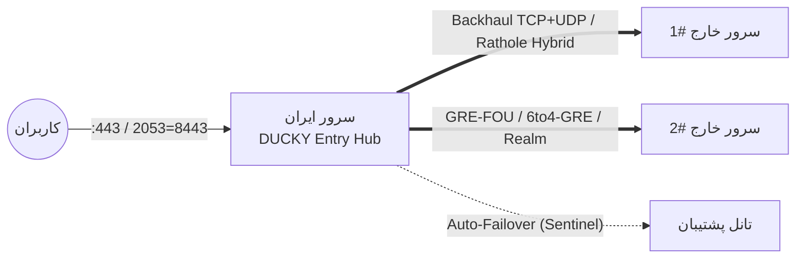
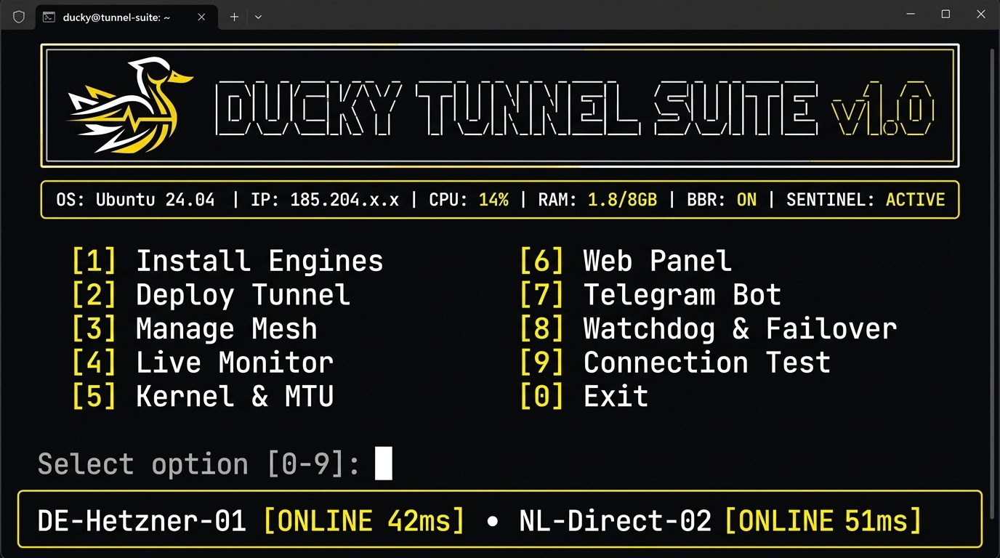
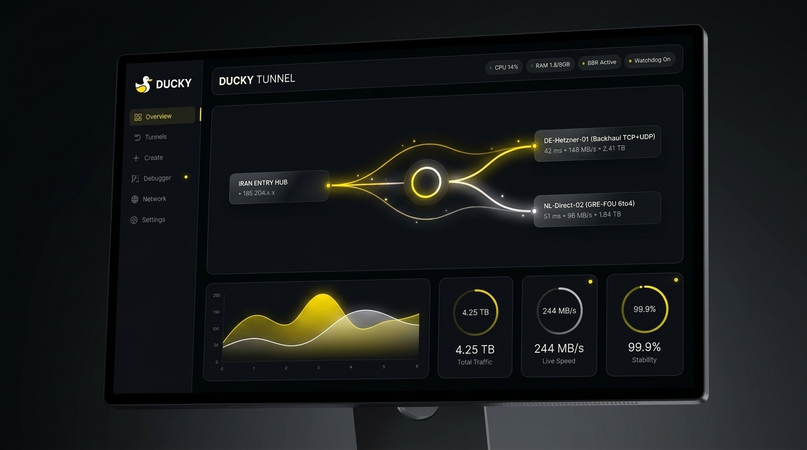

<p align="center">
  
</p>

<p align="center">
  
</p>

<p align="center">
  <a href="#فارسی"></a>
  <a href="#english"></a>
  <a href="https://t.me/Em4dloverS"></a>
  <a href="https://t.me/KaMr4ng"></a>
</p>

---

<div dir="rtl" id="فارسی">

# راهنمای کامل فارسی — DUCKY TUNNEL v1.0

**DUCKY** یک سامانه ماژولار، هوشمند و فوق‌سریع برای مدیریت تانل بین **سرور ایران** و **چندین سرور خارج** با تم اختصاصی **مشکی مات، سفید خالص و زرد الکتریک** است. تمام تنظیمات کرنل، بافرها، `BBR`، توزیع بار هسته‌های پردازنده (`RPS/RFS`) و `MTU` به‌صورت خودکار مطابق سخت‌افزار سرور شما محاسبه و اعمال می‌شود.

### معماری مسیر ترافیک



---

### قدم اول: نصب تک‌خطی روی سرور ایران و سرور خارج

این دستور را با دسترسی `root` روی **هر دو سرور** (Ubuntu 20.04 تا 26.04 یا Debian 11 تا 13) اجرا کنید:

```bash
bash <(curl -Ls https://raw.githubusercontent.com/emdabsii/DUCKY-Tunnel/main/install.sh)
```

پس از اتمام نصب، هر زمان خواستید منوی گرافیکی ترمینال را با دستور زیر باز کنید:

```bash
ducky
```

<p align="center">
  
</p>

---

### قدم دوم: فعال‌سازی وب‌پنل مدرن (مشکی / سفید / زرد)

در منوی `ducky` عدد **6** (`DUCKY Web Panel`) را بزنید تا وب‌پنل روی یک **پورت تصادفی و مسیر مخفی** بالا بیاید و آدرس، نام کاربری و رمز عبور به شما نمایش داده شود.

<p align="center">
  
</p>

---

### قدم سوم: ساخت تانل با پنجره شیشه‌ای زنده (آکواریوم فارسی)

در بخش **Create Tunnel** یکی از **۶۲ پروتکل تخصصی** (مثل `Backhaul TCP+UDP`، `Rathole TCP+UDP Hybrid`، `GRE-FOU`، `6to4-GRE` یا `Realm Rust`) را انتخاب کنید. هنگام ساخت تانل، پنجره شیشه‌ای سمت راست باز شده و خط‌به‌خط مراحل آنالیز سخت‌افزار، بهینه‌سازی کرنل و ساخت فایل‌های هسته را به‌صورت زنده نمایش می‌دهد:

<p align="center">
  
</p>

پس از ساخت تانل روی سرور ایران، لینک `ducky://...` را کپی کرده و روی سرور خارج فقط این یک خط را بزنید تا در ۱ ثانیه متصل شود:

```bash
ducky apply-link 'ducky://...'
```

---

### قدم چهارم: فعال‌سازی نگهبان ضد-لوپ (`Sentinel`) و ربات تلگرام

* **نگهبان خودترمیم‌گر + سوییچ به تانل جایگزین (`Auto-Failover`):** گزینه **8** منو را بزنید تا اگر تانلی قطع شد، ابتدا یک‌بار ری‌استارت هوشمند بزند و اگر باز هم وصل نشد، به‌صورت خودکار ترافیک را روی **تانل پشتیبان** سوییچ کرده و به شما در تلگرام هشدار دهد.
* **ربات کنترل تلگرام:** گزینه **7** منو (یا صفحه `Settings` در وب‌پنل) را باز کرده، توکن ربات و آیدی عددی خودتان را وارد کنید تا تمام تانل‌ها، Failover، بکاپ و بهینه‌سازی کرنل را مستقیم از داخل تلگرام کنترل کنید.

</div>

---

<a id="english"></a>

# English Documentation — DUCKY TUNNEL v1.0

**DUCKY** is a next-generation modular tunneling suite connecting an **Iran entry server** to **unlimited foreign exit servers**, crafted in a signature **Obsidian Black, Pure White & Electric Yellow** aesthetic. It features 62 specialized protocols, automatic hardware-aware kernel tuning (`BBR + Multi-Core RPS`), anti-loop **Sentinel Auto-Failover**, a frosted-glass real-time deployment drawer, and a built-in interactive **Telegram Control Bot**.

### Supported Protocol Families (62 Specialized Methods)

| Family | Protocols Included | Highlight |
| :--- | :--- | :--- |
| **Backhaul** | `tcp`, `tcpudp` (`accept_udp=true`), `tcpmux`, `udp`, `ws`, `wsmux`, `wss`, `wssmux` | Unified TCP+UDP, CDN `edge_ip`, auto-scaled CPU pool |
| **Rathole** | `hybrid` (simultaneous TCP+UDP in 1 TOML), `tcp`, `udp`, `noise`, `ws` | Ultra-lightweight Rust reverse tunnel |
| **GRE & Kernel** | `gre`, `gre-key`, `gretap`, `ipip`, `6to4-sit`, `6to4-gre`, `gre6`, `gre-fou`, `gre-gue`, `vxlan`, `geneve`, `dnat` | Isolated `10.88.N.0/30` subnets, port mapping (`2053=8443`), `TCPMSS` clamp |
| **WireGuard** | `wg`, `wg-psk`, `wg-1320`, `wg-1280` | `Table=off` (SSH-safe), automatic keygen |
| **Realm** | `realm-tcp`, `realm-tls`, `realm-ws` | Zero-copy Rust TCP+UDP high-speed forwarder |
| **FRP & GOST** | `frp-tcp/kcp/quic/ws` + 22 `gost` Relay & SOCKS5 transports | Loss recovery (KCP/QUIC) & Xray SOCKS5 outbounds |

### Quick Install

Run as `root` on both servers (Ubuntu 20.04–26.04 or Debian 11–13):

```bash
bash <(curl -Ls https://raw.githubusercontent.com/emdabsii/DUCKY-Tunnel/main/install.sh)
```

### Quick CLI Commands

| Command | Action |
| :--- | :--- |
| `ducky` | Open Black/White/Yellow Terminal Command Center |
| `ducky top` | Live 2-second refreshing tunnel ping & state monitor |
| `ducky link <NAME>` | Generate 1-second `ducky://` setup link |
| `ducky apply-link 'ducky://...'` | Deploy opposite server instantaneously |
| `ducky test` | Run connection & route diagnostic probe |
| `ducky doctor` | Hardware, BBR, Sentinel & network health check |
| `ducky backup` | Create full `.tar.gz` snapshot of `/etc/.ducky-vault` |
| `ducky update` | Pull latest version from GitHub / jsDelivr mirror |
